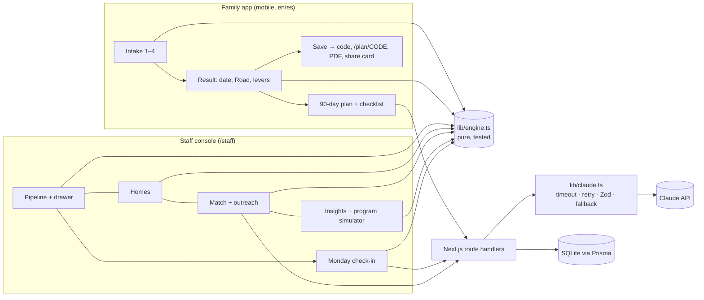

# HomeStretch: get the keys, keep the keys

Built at the Claude Impact Lab (UC Irvine × SoCal Affordable Housing) for Habitat for Humanity of Orange County and the UCI Merage Center for Real Estate. Live: https://homestretch-umber.vercel.app

Getting a family into a home is half the job; keeping them there is the other half, and it's getting harder. California homeowners insurance is up about 84% since 2020 and the FAIR Plan raised rates 29.1% on October 15, 2026. Rising insurance and property tax flow into escrow, so a family's payment jumps with little warning. Under Habitat's model, homeowner payments fund the next homes.

- **Keep** (`/keep`, the star): set up a home in two minutes (or drop an insurance renewal, escrow statement or tax bill and Claude reads it). A **24-month Payment Forecast** shows the family their payment before it changes, with shock markers and a breathing-room band; a **flatten slider** shows how a small set-aside absorbs the spike. **Shock Shield** ranks the moves that help (insurance, Homeowners' Exemption, CARE/FERA, set aside early, talk to Habitat early). **Home Health** turns a photo of a water-heater data plate into a monthly repair set-aside; **Relief Finder** and a **monthly check-in** keep it current. A one-page **My Home Plan** PDF.
- **Ready** (`/start`): four short screens (voice or type), a mortgage-ready date, the Road, levers, a 90-day plan, and **Your first year of owning**, a preview of the real monthly cost after closing.
- **Staff** (`/staff`): **Early warning** sorts every homeowner by risk of payment stress in the next six months and drafts bilingual outreach before anyone misses a payment; **Stress test** shows what a 29% insurance jump does across the portfolio and what a small program prevents, in dollars that fund the next homes; a **weekly digest** agent streams what changed; the **Ready pipeline**.
- **The numbers come from deterministic engines** (`lib/forecast.ts`, `lib/engine.ts`), unit-tested. Claude reads documents, explains and writes; it never produces a number.

## Architecture



## How Claude is used

Every call goes through `lib/claude.ts`: 20-second timeout, one retry, Zod validation, and a rules-based fallback, so the app still works with the network off. Each call's purpose and token count is logged.

| Route | What Claude does | Fallback |
|---|---|---|
| `POST /api/extract/paystub` | Reads a pay stub photo/PDF → employer, frequency, gross per period, YTD | Friendly error; manual entry stays |
| `POST /api/extract/statement` | Reads a bank statement → recurring debts, overdrafts, unexplained deposits | Friendly error; continue without |
| `POST /api/plan` | Writes "why this date" + a 90-day plan around the engine's numbers, in the family's language (cached per profile + language) | Rules-based plan from the engine |
| `POST /api/parse-speech` | Turns "somos cuatro… gano como cinco mil doscientos" into form fields | Rules-based es/en number parser |
| `POST /api/letter` | Drafts a lender letter of explanation, streamed | Fill-in-the-blank template |
| `POST /api/outreach`, `/api/match-reason` | Staff outreach drafts and one-line match reasons | Templates |
| `POST /api/checkin` | Per-family weekly digest and nudge, streamed as NDJSON | Template digest |

## How the engine works

`lib/engine.ts` is pure TypeScript with Vitest tests (`tests/`). From a profile it computes:

- **Tier**: annual income (work + other + co-applicant) against Habitat OC's 2026 table.
- **Need**: rent over 30% of income, more than 2 people per bedroom, or unsafe conditions.
- **Debt timeline**: month by month, with collections paid first, then the highest-APR card.
- **Credit**: when credit is ready (good → now; building → at least 6 months; needs work → debts + 6, at least 12).
- **Savings**: when savings reach 1% down plus about $1,500 in closing costs. Leftover debt budget rolls into savings once debts are paid.
- **Ready date and milestones**: ready = max(credit, savings). Orientation and application come just before; keys follow about 9 months after.

The same engine powers `solveForDate` (aim for a home), `tenYearComparison` (renting vs. owning), and `simulateProgram` (what a funded program would change). See `docs/DECISIONS.md` for every judgment call.

## Setup

```bash
git clone https://github.com/krishcal9-bit/homestretch && cd homestretch
```
```bash
npm run setup
```
```bash
# put your key in .env as APP_ANTHROPIC_API_KEY (and change STAFF_PASSWORD)
```
```bash
npm run dev
```

Open http://localhost:3000 (landing), http://localhost:3000/start (family intake) and http://localhost:3000/staff (staff, also linked as "Staff sign in" in the header). `MOCK_CLAUDE=1 npm run dev` runs without a key. Before a demo: `npm run preflight` (reseed, all checks, e2e, one real Claude call, then READY).

Quality gates: `npm run check` (tsc, eslint, vitest, prisma validate, next build) and `npm run e2e` (Playwright, mocked Claude: family flow, Spanish, staff, uploads, accessibility).

## Deploy to Vercel with Turso

Serverless functions have no persistent disk, so the live site stores plans in [Turso](https://turso.tech) (hosted libSQL). Prisma talks to it through `@prisma/adapter-libsql`; locally the app keeps using the SQLite file.

1. Create a database: `turso db create homestretch`, then `turso db show homestretch --url` and `turso db tokens create homestretch`.
2. Create the tables and demo data once, from your machine:
```bash
TURSO_DATABASE_URL=libsql://YOUR-DB.turso.io TURSO_AUTH_TOKEN=YOUR-TOKEN npm run turso:setup
```
3. In Vercel, import `krishcal9-bit/homestretch` and set `TURSO_DATABASE_URL`, `TURSO_AUTH_TOKEN`, `APP_ANTHROPIC_API_KEY` and `STAFF_PASSWORD`. Deploy. Every push to `main` redeploys.

`npm run turso:setup -- --reset` drops and recreates the tables (wipes saved plans).

## Demo script (3 minutes)

1. Load the site and let the intro play: the house builds, the key turns, "HomeStretch" fills the screen and flies to the header; the house lands on its street.
2. *"Getting families into homes is half the job. In California, insurance is up 84% since 2020 and the FAIR Plan just went up 29%. That shows up in a family's mortgage payment with almost no warning."* Press Down through the scenes (the shock on the kitchen wall, the water heater, Habitat seeing it first), then back to the top.
3. **I own a Habitat home** → **Try the sample family**: the Ramirez family, Santa Ana, on the FAIR Plan. (Or go through setup and tap **Use the sample notice** to drop their insurance renewal: the fields fill, tagged "From your document", and it reads: *"Your insurance is going up $412 a year… your payment goes up about $69 a month in March."*)
4. **Payment Forecast**: the line draws, the March spike drops in, breathing room turns red. Drag **Set aside each month**: the spike flattens; at the recommended $48 the marker says **Covered** and the red month is gone. *"$48 a month starting now, and March doesn't hurt."*
5. **Shock Shield**: apply the higher deductible and the Homeowners' Exemption and watch the rise shrink; **Talk to Habitat early** shows the message, in Spanish for a Spanish-speaking family.
6. Open `/staff` (password: `STAFF_PASSWORD`). **Early warning**: homeowners heading toward stress before anyone missed a payment (the count is computed live; 15 of 40 on Nov 7 2026). Open an Act now household and **Draft outreach** in Spanish.
7. **Stress test**: insurance at 29% puts homeowners at risk; turn on a $150/month matched repair fund and the count drops, with the yearly payments protected (e.g. 15 → 7, about $15,600 a year that keeps funding the next homes).
8. Close: *"Habitat builds the homes. HomeStretch helps families get the keys, and keep them."*

## What Habitat OC would need to adopt this

- **Hosting**: one small Next.js app plus a SQLite/Turso database. Vercel Hobby or Pro plus Turso's free tier costs $0–$20 a month. Claude usage runs about 3–6k tokens per family plan, a few cents per family.
- **Data policy**: uploaded pay stubs and statements are processed in memory and never stored. Plans are private by default; staff see a plan only when the family shares its code. The database holds no SSNs and no documents. Habitat should still review retention (for example, delete plans 24 months after last activity) and add its privacy notice.
- **Spanish review**: UI copy lives in `messages/es.json` and was written for this demo. A native-speaking Habitat staff member or volunteer should review it, plus the letter and nudge prompts, before families use it.
- **Numbers to confirm**: income tiers for households of 5–8 are estimated (`lib/incomeTiers.ts`). Down payment and closing cost rules (`lib/engine.ts`, top of file) should match Habitat OC's current program.
- **Not included yet**: real SMS/email sending (mocked), staff accounts beyond one shared password, and an audit log.
