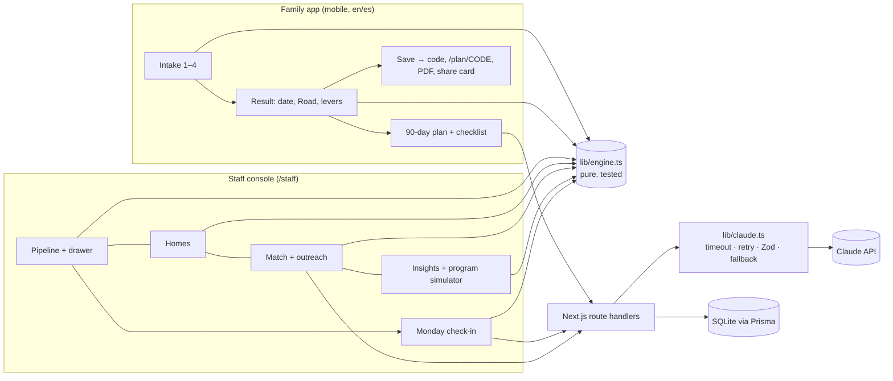

# Homestretch

Built at the Claude Impact Lab, UC Irvine, November 7 2026, for Habitat for Humanity of Orange County.

Homestretch answers one question for every family Habitat OC meets: **how far is this family from keys, what exactly closes the gap, and which upcoming home can they realistically get?**

- **Families** answer four short screens (or say their answers out loud, or scan a pay stub) and get a date, a road to keys, and a 90-day plan in English or Spanish.
- **Sliders** show what changes the date: extra toward debt, monthly savings, a co-applicant. "Aim for a specific home" works the plan backwards from a real Habitat build.
- **Staff** see every family who shared their code in one pipeline, grouped by when they'll be mortgage-ready, matched against the homes Habitat is actually building.
- **A Monday check-in** finds who moved, who stalled and who now fits a home, and drafts a nudge in the family's language. Nothing sends automatically.
- **The numbers come from a deterministic engine** (`lib/engine.ts`), not from an LLM. Claude explains, reads documents and writes; it never decides a date.

Screenshots: [result](docs/screenshots/step4-result-mobile.png) · [plan](docs/screenshots/step5-plan-page-mobile.png) · [Underwriter's eye](docs/screenshots/step6-underwriters-eye-mobile.png) · [voice](docs/screenshots/step10-voice-es-mobile.png) · [pipeline](docs/screenshots/step7-pipeline.png) · [drawer](docs/screenshots/step7-drawer.png) · [insights](docs/screenshots/step9-insights.png) · [check-in](docs/screenshots/step11-checkin.png) · motion clip in [docs/motion](docs/motion).

## Architecture



## How Claude is used

Every call goes through `lib/claude.ts`: 20-second timeout, one retry, Zod validation, and a rules-based fallback, so the app still works with the network off. Each call's purpose and token count is logged.

| Route | What Claude does | Fallback |
|---|---|---|
| `POST /api/extract/paystub` | Reads a pay stub photo/PDF → employer, frequency, gross per period, YTD | Friendly error; manual entry stays |
| `POST /api/extract/statement` | Reads a bank statement → recurring debts, overdrafts, unexplained deposits | Friendly error; continue without |
| `POST /api/plan` | Writes "why this date" + a 90-day plan around the engine's numbers, in the family's language (cached per profile + language) | Rules-based plan from the engine |
| `POST /api/parse-speech` | Turns "somos cuatro… gano como cinco mil doscientos" into form fields | Rules-based es/en number parser |
| `POST /api/letter` | Drafts a lender letter of explanation, streamed | Fill-in-the-blank template |
| `POST /api/outreach`, `/api/match-reason` | Staff outreach drafts and one-line match reasons | Templates |
| `POST /api/checkin` | Per-family weekly digest and nudge, streamed as NDJSON | Template digest |

## How the engine works

`lib/engine.ts` is pure TypeScript with Vitest tests (`tests/`). From a profile it computes:

- **Tier**: annual income (work + other + co-applicant) against Habitat OC's 2026 table.
- **Need**: rent over 30% of income, more than 2 people per bedroom, or unsafe conditions.
- **Debt timeline**: month by month, with collections paid first, then the highest-APR card.
- **Credit**: when credit is ready (good → now; building → at least 6 months; needs work → debts + 6, at least 12).
- **Savings**: when savings reach 1% down plus about $1,500 in closing costs. Leftover debt budget rolls into savings once debts are paid.
- **Ready date and milestones**: ready = max(credit, savings). Orientation and application come just before; keys follow about 9 months after.

The same engine powers `solveForDate` (aim for a home), `tenYearComparison` (renting vs. owning), and `simulateProgram` (what a funded program would change). See `docs/DECISIONS.md` for every judgment call.

## Setup

```bash
git clone https://github.com/krishcal9-bit/homestretch && cd homestretch
```
```bash
npm run setup
```
```bash
# put your key in .env as APP_ANTHROPIC_API_KEY (and change STAFF_PASSWORD)
```
```bash
npm run dev
```

Open http://localhost:3000 (family) and http://localhost:3000/staff (staff). `MOCK_CLAUDE=1 npm run dev` runs without a key. Before a demo: `npm run preflight` (reseed, all checks, e2e, one real Claude call, then READY).

Quality gates: `npm run check` (tsc, eslint, vitest, prisma validate, next build) and `npm run e2e` (Playwright, mocked Claude: family flow, Spanish, staff, uploads, accessibility).

## Deploy to Vercel with Turso

Serverless functions have no persistent disk, so the live site stores plans in [Turso](https://turso.tech) (hosted libSQL). Prisma talks to it through `@prisma/adapter-libsql`; locally the app keeps using the SQLite file.

1. Create a database: `turso db create homestretch`, then `turso db show homestretch --url` and `turso db tokens create homestretch`.
2. Create the tables and demo data once, from your machine:
```bash
TURSO_DATABASE_URL=libsql://YOUR-DB.turso.io TURSO_AUTH_TOKEN=YOUR-TOKEN npm run turso:setup
```
3. In Vercel, import `krishcal9-bit/homestretch` and set `TURSO_DATABASE_URL`, `TURSO_AUTH_TOKEN`, `APP_ANTHROPIC_API_KEY` and `STAFF_PASSWORD`. Deploy. Every push to `main` redeploys.

`npm run turso:setup -- --reset` drops and recreates the tables (wipes saved plans).

## Demo script (3 minutes)

1. Open `/` at phone size and let the landing page load: the headline rises, the sample road draws and the date rolls in. Drag **Extra toward debt** on the sample family. Then tap **Start**, toggle **ES**, tap the microphone (or "O escriba lo que diría") and say *"somos cuatro, vivimos en Santa Ana, gano como cinco mil doscientos al mes, pagamos dos mil trescientos cincuenta de renta."* Watch the fields fill. Switch back to English.
2. On the income screen, upload `public/samples/paystub.png` and watch income fill. On the money screen add a $1,900 collection and $3,100 saved (credit: needs work).
3. Land on the result. Let the Road draw. Read the date aloud. Drag **Extra toward debt** to $150 and watch the date pull years closer. *"That's the conversation Habitat has never been able to have in a number."*
4. **Aim for a specific home**: pick the Westminster 4-bedroom. The sliders glide to the solved plan, the Road redraws, and the sentence says exactly what it takes. Scroll to **Ten years from now** and read the equity number.
5. Upload `public/samples/bank-statement.pdf` on the money screen to show **Underwriter's eye**; tap **Write my explanation letter**.
6. Open `/staff`. Pipeline: 4 families ready in ≤ 6 months. Homes: which builds have families ready by completion. Match: **Draft outreach**.
7. Insights: toggle **Matched savings** and read the headline: more families ready by December 2027, and what it costs.
8. Click **Run Monday check-in** and let the families stream in. Close on: *"Habitat finishes 100 homes; Homestretch makes sure 100 families are ready to buy them, and never loses one on the way."*

## What Habitat OC would need to adopt this

- **Hosting**: one small Next.js app plus a SQLite/Turso database. Vercel Hobby or Pro plus Turso's free tier costs $0–$20 a month. Claude usage runs about 3–6k tokens per family plan, a few cents per family.
- **Data policy**: uploaded pay stubs and statements are processed in memory and never stored. Plans are private by default; staff see a plan only when the family shares its code. The database holds no SSNs and no documents. Habitat should still review retention (for example, delete plans 24 months after last activity) and add its privacy notice.
- **Spanish review**: UI copy lives in `messages/es.json` and was written for this demo. A native-speaking Habitat staff member or volunteer should review it, plus the letter and nudge prompts, before families use it.
- **Numbers to confirm**: income tiers for households of 5–8 are estimated (`lib/incomeTiers.ts`). Down payment and closing cost rules (`lib/engine.ts`, top of file) should match Habitat OC's current program.
- **Not included yet**: real SMS/email sending (mocked), staff accounts beyond one shared password, and an audit log.
